# AI Web Security Posture Agent (Pixel Edition)

เว็บแอปพลิเคชันสำหรับ **ตรวจประเมินความปลอดภัยเว็บไซต์เชิงป้องกันแบบ Passive / Read-Only** ตามแนวทาง OWASP โดยผสานการทำงานของ **Playwright + HTTP Client**, **Tool-Using AI Agent** (รองรับ OpenTyphoon, OpenAI-compatible, Google Gemini, Local Ollama และโหมด Offline), **Live SSE Streaming**, **SQLite History & Before/After Diff** และอินเทอร์เฟซ **Retro Pixel Art Wizard** พร้อมมาสคอสน้องแมงมุม Pixel

> **ขอบเขตความปลอดภัย (Scope & Safety)**
> โปรเจกต์นี้ออกแบบมาเพื่อการตรวจสอบคอนฟิกและท่าทีการป้องกันเชิงรับแบบ **Passive / Read-Only เท่านั้น**  
> **ไม่มีการส่ง Payload โจมตี (SQLi/XSS/SSRF), ไม่มีการยิง Fuzzing/Brute-force และไม่มีเครื่องมือเจาะระบบ**

---

## สถาปัตยกรรมและขั้นตอนการทำงาน

```mermaid
flowchart LR
    U["1. Target URL + AI Config"] --> R["Playwright + httpx Passive Recon"]
    R --> P["Planner Agent + 5 Passive Tools"]
    P -->|"SSE Stream (/api/recon/stream)"| S2["2. Existing Defenses & Ordered Plan"]
    S2 -->|"User Picks & Reorders"| E["3. Ordered Check Runner (/api/execute/stream)"]
    E --> A["Advisor Agent + Stack Detection"]
    A --> DB["SQLite History & Before/After Diff"]
    DB --> RPT["4. Security Posture Report (MD / JSON / PDF)"]
```



### Flow การใช้งาน 4 ขั้นตอน (Step-by-Step Wizard)
1. **ระบุเป้าหมาย (`Step 1`):** กรอก URL หรือเลือกปุ่ม Sandbox ในเครื่อง (`Demo: Weak Config`, `Demo: Hardened Config`) พร้อมสตรีม **Live Agent Pipeline** แสดงการเปิดหน้าเว็บและเครื่องมือที่ AI Agent เรียกใช้แบบ Real-time
2. **ตรวจผลเบื้องต้น & จัดลำดับ (`Step 2`):** ดูรายการ **ส่วนที่มีการป้องกันดีอยู่แล้ว**, **Tool Trace ที่ AI เรียกใช้**, และติ๊กเลือก/จัดลำดับหัวข้อที่ต้องการตรวจด้วยปุ่ม `↑`/`↓` หรือลากวาง (พร้อมปุ่ม **ย้อนกลับ** ทุกหน้า)
3. **ดำเนินการตรวจตามลำดับ (`Step 3`):** รันตัวตรวจที่เลือกทีละข้อตามลำดับจริง พร้อมอัปเดตสถานะผ่าน SSE
4. **รายงานสรุป (`Step 4`):** แสดงคะแนน (`0–100`), เกรด (`A`–`F`), **Before vs After Diff** เทียบกับการตรวจเว็บเดิมครั้งก่อน, **คำแนะนำจาก Advisor Agent ตาม Stack**, หลักฐานที่พบ, ตัวอย่างการตั้งค่าเชิงป้องกัน และปุ่มดาวน์โหลด **Markdown / JSON / พิมพ์ PDF**

---

## ความสามารถหลัก

### 1. Passive Reconnaissance (`app/recon.py`)
- ใช้ **Playwright** (Headless Chromium พร้อม Fallback อัตโนมัติไปยัง Chromium ในเครื่อง / Chrome / Edge หรือ HTML parser) ร่วมกับ `httpx`
- อ่านข้อมูลแบบ Read-Only: HTTP status, Redirect chain, HTTP→HTTPS redirect, Response Headers, Cookie metadata flags (`HttpOnly`, `Secure`, `SameSite` — ไม่บันทึกค่า secret), DOM (`forms`, `scripts`, `a[target="_blank"]`, `iframes`, `same_origin_links`), Mixed Content, Observed CORS headers, `/.well-known/security.txt` และ `/robots.txt`

### 2. Tool-Using AI Agent (`app/agent.py`, `app/tools.py`)
- **Planner Agent (`generate_audit_plan`):** รองรับ Function Calling (`tools` / `tool_calls`) เพื่อตัดสินใจเรียกใช้ **5 Passive Read-Only Tools** เอง พร้อม Context Compression (`_compress_telemetry_for_llm`) และ Tool Cache:
  - `inspect_tls_certificate` — ตรวจโปรโตคอล TLS, ผู้ออกใบรับรอง และวันหมดอายุที่เหลือ
  - `parse_csp_directives` — แยกวิเคราะห์ Directive ของ `Content-Security-Policy` ทีละส่วน
  - `check_dns_security_records` — ตรวจ DNS สาธารณะ (`CAA`, `SPF`, `DMARC`) แบบ Passive
  - `inspect_same_origin_subpage` — เปิดอ่านหน้าย่อยภายในโดเมนเดียวกันที่พบ (จำกัดสูงสุด 2 หน้า และบล็อกลิงก์ต่างโดเมนทันที)
  - `fetch_public_security_files` — อ่านข้อมูลเบื้องต้นจาก `/.well-known/security.txt` และ `/robots.txt`
- **Advisor Agent (`summarize_report`):** ตรวจจับ Stack เบื้องต้นจาก Header (`detect_tech_stack` เช่น FastAPI/Uvicorn, Nginx, Cloudflare, Express, Next.js) เพื่อสรุปรายงานและให้คำแนะนำการตั้งค่าที่ตรง Stack
- **รองรับหลาย AI Provider + Automatic Fallback:**
  - `auto` / `offline` — ทำงานได้ทันทีด้วย **Offline Rule-Based Agent** โดยไม่ต้องใช้ API Key
  - `openai` — รองรับ OpenAI และ OpenAI-compatible APIs (เช่น **OpenTyphoon** `typhoon-v2.5-30b-a3b-instruct`)
  - `gemini` — รองรับ Google Gemini Function Calling
  - `ollama` — รองรับ Local LLM ผ่าน Ollama

### 3. 8 Passive OWASP Checks (`app/checks.py`)
| Check ID | หัวข้อที่ตรวจ | มาตรฐานอ้างอิง |
|---|---|---|
| `https_transport` | การเข้ารหัส HTTPS, HTTP→HTTPS Redirect และ HSTS | OWASP ASVS V9.1 |
| `security_headers` | `CSP`, `X-Content-Type-Options`, `Referrer-Policy`, `Permissions-Policy`, `COOP` | OWASP Secure Headers |
| `clickjacking_defense` | `X-Frame-Options` และ CSP `frame-ancestors` | OWASP Clickjacking Defense |
| `cookie_hygiene` | ตรวจ Flag `HttpOnly`, `Secure` และ `SameSite` | OWASP Session Management |
| `mixed_content_sri` | Mixed Content และ Subresource Integrity (`integrity`) ของสคริปต์ภายนอก | OWASP A08:2021 |
| `form_client_hygiene` | ฟอร์มที่ส่งผ่าน HTTP, Password input, Anti-CSRF hint และ `rel="noopener noreferrer"` | OWASP ASVS V5 |
| `cors_info_disclosure` | นโยบาย CORS และ Banner/Version disclosure (`Server`, `X-Powered-By`) | OWASP A05:2021 |
| `security_metadata` | `/.well-known/security.txt`, `/robots.txt` และ `Cache-Control` | RFC 9116 / OWASP |

### 4. SQLite History, Before/After Diff & Pixel UI
- **SQLite Persistence (`app/storage.py`):** บันทึกทุกรายงานลง `data/audit_history.db` เปิดดูย้อนหลังผ่านปุ่ม `HISTORY` และเทียบคะแนนรอบก่อน–รอบล่าสุดให้อัตโนมัติ
- **Pixel Art UI + Spider Mascot (`app/static/`):** ธีม Monochrome Dark Slate + Cyan Accent พร้อมน้องแมงมุม Pixel ที่เดินลาดตระเวนทั่วหน้าเว็บ ลาก-วางได้ ยิงใยโหนตัว (`WEB SHOT`) และเปลี่ยนอีโมต (ส่องแว่นขยาย, อ่านหนังสือ, ถือโล่, จิบกาแฟ, ดีใจ) สอดคล้องกับแต่ละขั้นตอนของการตรวจ

### 5. การป้องกันความปลอดภัยของตัวระบบเอง
- **URL Validation (`app/config.py`):** อนุญาตเฉพาะ `http://` และ `https://` ปฏิเสธ scheme อันตราย (`javascript:`, `file:`, `ftp:`), URL ที่มี credentials และ IP ประเภท link-local / cloud metadata (`169.254.169.254`)
- **Tool Allowlist & Same-Origin Guard (`app/tools.py`):** ปฏิเสธชื่อเครื่องมือที่ไม่อยู่ใน `PASSIVE_TOOLS` และบังคับ `same-origin`
- **Prompt Injection & XSS Defense:** ห่อข้อมูลจากหน้าเว็บด้วย `<untrusted_telemetry>` ใน Prompt และ Escape HTML ทุกข้อความก่อนแสดงผลบนหน้าเว็บ

---

## โครงสร้างโปรเจกต์

```text
AIE483/
├── app/
│   ├── main.py          # FastAPI routes, SSE streams (/api/recon/stream, /api/execute/stream), History API
│   ├── config.py        # Settings, DB path resolver และ URL validation
│   ├── models.py        # Pydantic schemas (Recon, ToolTrace, Report, Diff, History)
│   ├── recon.py         # Passive reconnaissance engine (httpx + Playwright)
│   ├── tools.py         # 5 Passive read-only tools สำหรับ AI Agent Function Calling
│   ├── checks.py        # 8 modular passive OWASP posture checks
│   ├── agent.py         # Planner & Advisor Agents, Context Compression, Tool Loops + Offline Fallback
│   ├── storage.py       # SQLite persistence และ Before/After report diff
│   ├── report.py        # Weighted scoring, grading (A-F) และ Markdown exporter
│   ├── demo.py          # Built-in Demo Sandboxes (/demo/vulnerable-config, /demo/hardened)
│   └── static/          # Pixel Art Wizard UI & Spider Mascot (index.html, styles.css, app.js)
├── tests/
│   ├── conftest.py
│   ├── test_checks.py
│   ├── test_agent_and_api.py
│   ├── test_tools_and_agent_loop.py
│   └── test_storage_and_streaming.py
├── requirements.txt
├── pyproject.toml
└── .env.example
```

---

## วิธีติดตั้งและรันใช้งาน

### 1. สร้าง Virtual Environment และติดตั้ง Dependencies
```powershell
python -m venv .venv
.\.venv\Scripts\Activate.ps1
pip install -r requirements.txt
playwright install chromium
```
*(บน Windows หากยังไม่ได้สั่ง `playwright install chromium` ระบบมี Fallback ไปยังเบราว์เซอร์ Chromium ในเครื่อง / Chrome / Edge อัตโนมัติ)*

### 2. (ทางเลือก) ตั้งค่า AI Provider ผ่าน `.env`
โปรโตไทป์รันได้ทันทีในโหมด **Offline Rule-Based Agent** โดยไม่ต้องใช้ API Key  
หากต้องการเชื่อมต่อ LLM จริง ให้คัดลอก `.env.example` เป็น `.env` (ไฟล์ `.env` ถูกกันไว้ใน `.gitignore` แล้ว) หรือกรอกในหน้าเว็บ:

```env
# ตัวอย่างการใช้ OpenTyphoon (OpenAI-compatible)
AI_PROVIDER=openai
OPENAI_API_KEY=YOUR_API_KEY
OPENAI_BASE_URL=https://api.opentyphoon.ai/v1
OPENAI_MODEL=typhoon-v2.5-30b-a3b-instruct
```

### 3. เปิดใช้งานเว็บแอปพลิเคชัน
```powershell
.\.venv\Scripts\uvicorn.exe app.main:app --host 127.0.0.1 --port 8000
```
จากนั้นเปิดเบราว์เซอร์ไปที่ `http://127.0.0.1:8000`

### 4. รันชุดทดสอบ (Pytest)
```powershell
.\.venv\Scripts\pytest.exe -v
```
*(ชุดทดสอบแยก SQLite DB ชั่วคราวใน `tmp_path` อัตโนมัติ ไม่รบกวนข้อมูลจริงใน `data/audit_history.db`)*

---

## API Endpoints หลัก

| Method | Path | คำอธิบาย |
|---|---|---|
| `GET` | `/api/health` | ตรวจสถานะเซิร์ฟเวอร์และรายการ Check ที่รองรับ |
| `POST` | `/api/recon` | สำรวจเบื้องต้น + สร้างแผนการตรวจ (JSON) |
| `POST` | `/api/recon/stream` | สำรวจเบื้องต้น + สตรีมการเรียก Tool ของ AI Agent แบบ Real-time (SSE) |
| `POST` | `/api/execute` | รันหัวข้อที่เลือกตามลำดับและคืนรายงาน (JSON) |
| `POST` | `/api/execute/stream` | รันหัวข้อที่เลือกตามลำดับพร้อมสตรีมความคืบหน้าและสรุปรายงาน (SSE) |
| `GET` | `/api/reports` | ดูรายการประวัติรายงานที่บันทึกไว้ใน SQLite |
| `GET` | `/api/reports/{report_id}` | โหลดรายงานฉบับเต็มตาม ID |
| `GET` | `/api/reports/{report_id}/export` | ดาวน์โหลดรายงาน (`?format=markdown` หรือ `?format=json`) |
| `GET` | `/demo/vulnerable-config` | หน้า Demo Sandbox ที่ตั้งค่าความปลอดภัยแบบอ่อนแอ |
| `GET` | `/demo/hardened` | หน้า Demo Sandbox ที่ตั้งค่า Security Headers ตามแนวทาง OWASP |
